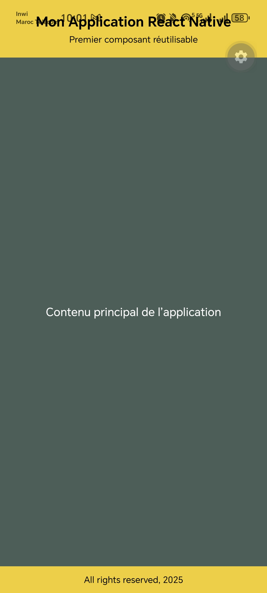
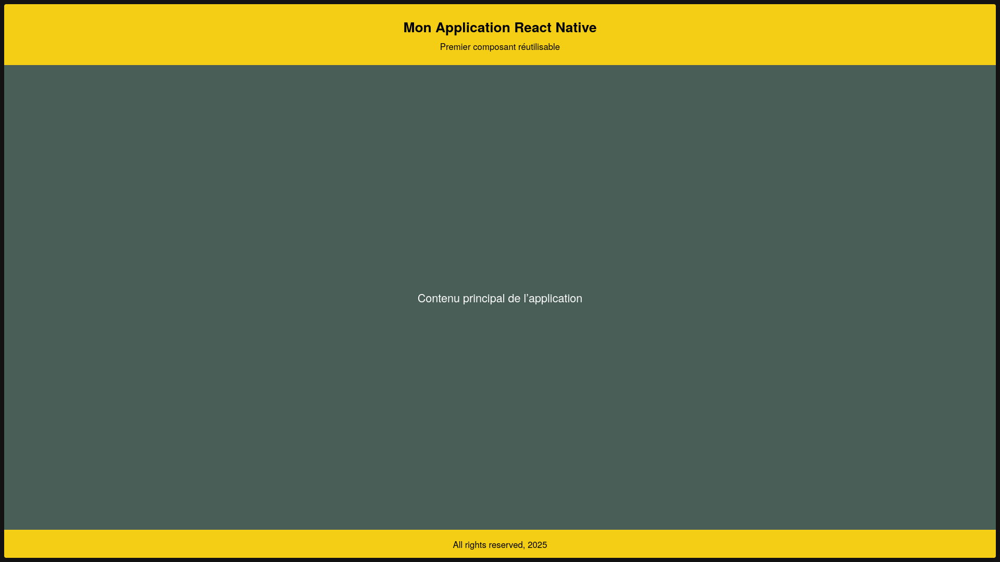

# Lab 1 — Premier projet mobile avec React Native

L’application ouverte dans Expo Go sur Android affiche un en-tête jaune, un texte centré et un pied de page avec le copyright.



La version web affiche la même disposition dans le navigateur.



Depuis le dossier du projet, lancer la commande suivante, puis scanner le QR code dans Expo Go.

```bash
npx expo start --go
```

Nous avons rencontré un problème de connexion entre le téléphone et l’ordinateur. Pour que le téléphone puisse joindre le serveur Expo en mode local, il faut connecter les deux appareils au même réseau Wi-Fi.
